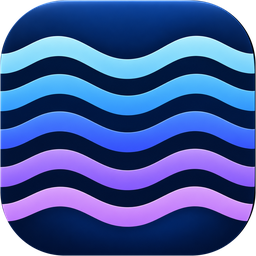
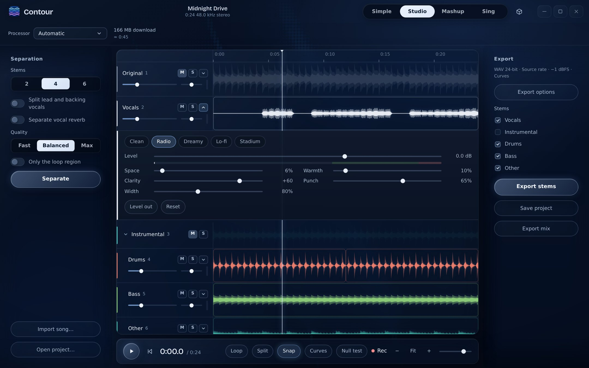
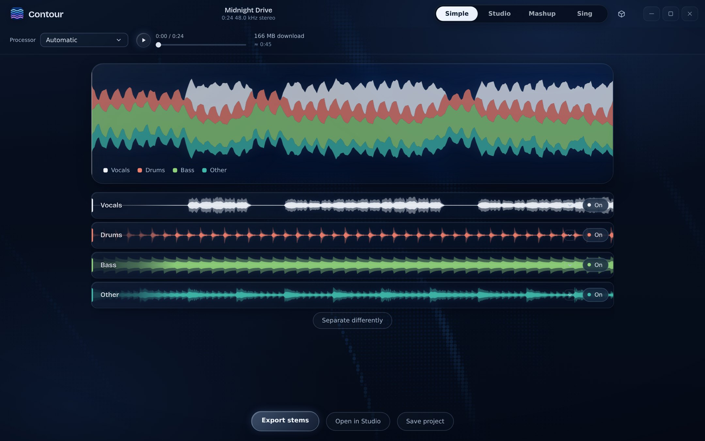
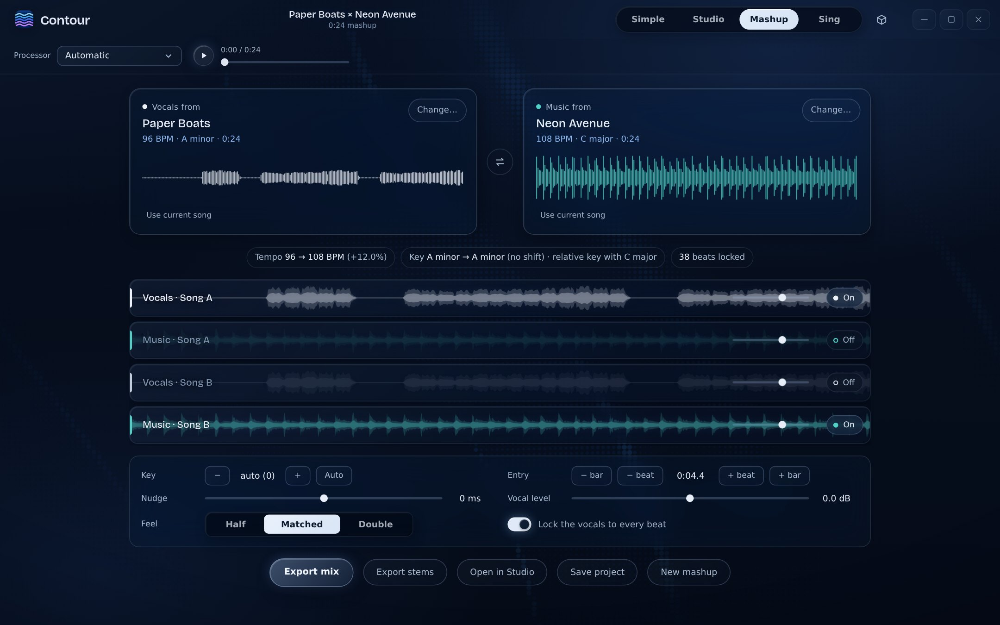
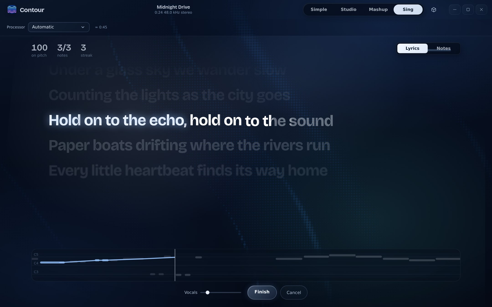
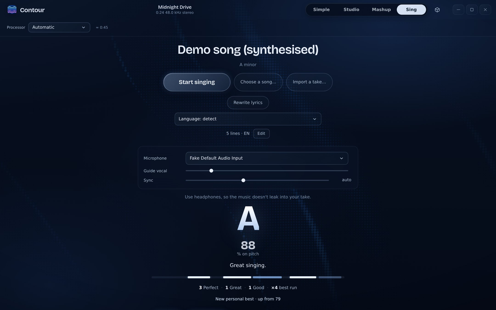

<div align="center">



# Contour

**Split any song into stems. Sing it. Remix it. Mix it beautifully.**<br>
All on your own computer. Nothing is ever uploaded.

[](https://github.com/apexrajveer-creator/contour/releases/latest)
[](#system-requirements)
[](LICENSE)
[](https://github.com/apexrajveer-creator/contour/actions/workflows/ci.yml)



</div>

## Why Contour

- **Private by design.** Separation, lyrics, tuning and mixing all run locally. Your music never leaves your computer.
- **Studio-grade separation.** The flagship Mel-Band RoFormer model beats the classic vocal models on the MUSDB18 benchmark (see [Quality](#quality)).
- **Beautiful without training.** Hover a preset and hear it. Press *Level out* and a vocal sits at one volume. A safety limiter means nothing ever distorts.
- **Real tools when you want them.** Clips, crossfades, lanes, curves, precision drags, a command palette.

## Four ways to use it

### Simple: drop a song, get stems
Choose *Remove vocals*, *Isolate vocals*, *Split into 4* or *Split into 6*. Watch the stems appear, switch them on and off, and export.



### Studio: edit and mix
- Every stem is a lane with mute, solo, level, pan and volume curves.
- Split, move, trim, fade and duplicate clips; **automatic crossfades** wherever clips meet; **box select** (Ctrl + drag); hold **Alt** for 10× precision.
- Open any stem's **▾ Sound drawer**: presets per stem type (Vocals: Clean, Radio, Dreamy, Lo-fi, Stadium · Drums · Bass · Instrumental), Level up to +12 dB, Space (reverb), Warmth, Clarity, Punch and Width, all heard live while you drag, and rendered identically on export.
- **Level out** evens a stem's loud and quiet passages. **Record** (R) straight onto a new lane.
- Drag lanes to reorder, double-click to rename, add any audio file as a lane.

### Mashup: one singer, another band
Pick a song for the vocals and one for the music. Contour separates both, locks the vocal to the music's beat grid, matches the key, and gives you four lanes (Vocals A, Music A, Vocals B, Music B) to blend however you like. Changes re-render in seconds.



### Sing: karaoke, done properly
- **Lyrics written on your computer** by OpenAI's Whisper from the separated vocal, timed to the syllables actually sung, shown in an Apple Music style: big, soft, springy, with a word-by-word sweep.
- **Live pitch** on a slim note strip; the line glows when you're on pitch.
- **Gentle scoring:** a quiet *Perfect · Great · Good* as each line ends, a grade, a timeline of every line, and personal bests.
- **Tune it:** pitch-correct your take to the melody or the key, from natural to robotic, keeping your vibrato.
- **Import a take** recorded elsewhere, and it lines up automatically.

<table><tr>
<td></td>
<td></td>
</tr></table>

> Easter egg: type **tune** anywhere in the app.

## Download

1. Grab **`Contour_1.0.0_x64-setup.exe`** from the [latest release](https://github.com/apexrajveer-creator/contour/releases/latest).
2. Run it. The installer downloads the core models (~890 MB, once, verified by SHA-256) so Contour works offline afterwards.
3. Open a song and go.

> **"Windows protected your PC"?** Version 1.0 isn't code-signed yet, so SmartScreen may warn about an unknown publisher. Click **More info → Run anyway**. Signed builds are on the roadmap.

## System requirements

|  | Minimum | Recommended |
|---|---|---|
| **OS** | Windows 10 (64-bit, 21H2+) | Windows 11 |
| **CPU** | 4 cores with AVX2 | 6-8 modern cores |
| **RAM** | 8 GB | 16 GB |
| **GPU** | Not required | Any DirectX 12 GPU with 4 GB+ (e.g. RTX 3050 / 4060 / 5050, RX 6600, Arc A380) |
| **Disk** | 3 GB free | 6 GB free on an SSD |
| **Display** | 1280 × 720 | 1920 × 1080 |

Internet is needed only for the one-time model downloads. For Sing, use **wired headphones**.

<details>
<summary>Rough speeds for a 4-minute song</summary>

| Task | 6-core CPU | RTX 3050-class GPU |
|---|---|---|
| Vocals + instrumental (Balanced) | 1-3 min | 15-30 s |
| 4 stems | 2-5 min | 30-60 s |
| Max quality (RoFormer) | 6-10 min | 1-2 min |
| Lyrics (Whisper, CPU) | 1-2 min | 1-2 min |
| Mashup re-render | seconds | seconds |

Estimates; your hardware may differ. The first run of each model is slower while it warms up.
</details>

## Quality

Vocal separation quality (SDR, higher is better) on three MUSDB18 test tracks:

| Track | UVR-MDX-Net Voc FT | **Mel-Band RoFormer (Max)** |
|---|---|---|
| AM Contra | 12.60 dB | **13.49 dB** |
| Cristina Vane | 17.37 dB | **18.76 dB** |
| Louis Cressy | 11.74 dB | **12.24 dB** |

Every mixing effect is implemented twice, in the Rust engine for exports and on the audio thread for the live preview, and the two agree to within 2.4 × 10⁻⁷ on the same test signal (the reverb is bit-exact). What you hear while dragging is what you export.

## Handy shortcuts

| Key | Does |
|---|---|
| **Space** | Play / pause |
| **Ctrl + K** | Command palette |
| **1-9** | Play only that stem · **Shift + 1-9** add or remove it · **0** everything back |
| **S** · **C** · **V** | Split at playhead · split tool · select tool |
| **Ctrl + drag** | Box-select clips across lanes |
| **Alt + drag** | Precision: a tenth of the speed, no snapping |
| **R** | Record in Studio |
| **Ctrl + Z** / **Ctrl + Shift + Z** | Undo / redo |
| **?** | All shortcuts |

## Privacy

Contour has no accounts, no analytics and no telemetry. Audio is processed locally; the only network traffic is downloading models from their pinned, checksummed sources. Projects (`.contour`) are plain JSON plus lossless FLAC stems, saved where you choose.

## Build from source

**Prerequisites:** [Rust](https://rustup.rs) (stable, 1.85+), [Node.js](https://nodejs.org) 20+, and on Windows the *Desktop development with C++* workload from Visual Studio Build Tools (WebView2 ships with Windows 11).

```bash
git clone https://github.com/apexrajveer-creator/contour.git
cd contour
npm ci
npm run dev            # run the app
npm run build          # build the installer (src-tauri/target/release/bundle)
npm run build:cuda     # optional: NVIDIA CUDA build (needs CUDA 13 + cuDNN 9)
```

**Tests**

```bash
cargo test --release -p contour-engine   # engine: separation helpers, analysis, stretch, tune, effects, lyrics timing
cargo test -p contour --lib               # app: projects, recovery, clips, export naming
npm test                                  # interface workflow tests
```

**Command-line tools** (`contour-cli`): `separate`, `mashup`, `lyrics`, `fxcheck`, `models`. Handy for benchmarks and debugging.

<details>
<summary>Project layout</summary>

```
engine/        Rust engine: ONNX inference, STFT, analysis, stretch, mashup, tune, effects, Whisper
  vendor/      Signalsmith Stretch (MIT)
src-tauri/     Desktop shell: commands, projects & recovery, export, installer hooks
ui/            Interface (vanilla JS + Web Audio + AudioWorklets)
docs/          Architecture notes and screenshots
tests/         Interface tests
```
See [docs/ARCHITECTURE.md](docs/ARCHITECTURE.md) for how everything fits together.
</details>

## Roadmap

- One-click mastering and *Balance for me*
- Share a performance as a video with lyrics
- Word-level lyric alignment and romanised lyrics (Hindi, Tamil, …)
- Lyrics on the GPU · song key and tempo controls · video import and MP3 export
- Code-signed builds, auto-updates, macOS

## Credits

Contour stands on wonderful open work:

| Component | By | License |
|---|---|---|
| UVR-MDX-Net Voc FT, Kim Vocal 2, Karaoke 2, Reverb HQ | Ultimate Vocal Remover community | MIT |
| HT-Demucs (4- and 6-stem) | Meta AI Research | MIT |
| Mel-Band RoFormer (Kim), ONNX by phuongnse | Kimberley Jensen et al. | See model card |
| Whisper large-v3-turbo, ONNX by onnx-community | OpenAI | MIT |
| Signalsmith Stretch | Signalsmith Audio | MIT |
| ONNX Runtime | Microsoft | MIT |
| Tauri | Tauri Programme | MIT / Apache-2.0 |
| Symphonia | Philip Deljanov et al. | MPL-2.0 |
| Bricolage Grotesque | Mathieu Triay | SIL OFL 1.1 |

Full notices are in [THIRD-PARTY-NOTICES.md](THIRD-PARTY-NOTICES.md).

## License

Contour's own source code is released under the [MIT License](LICENSE). Models and libraries keep their own licenses (above).

<div align="center"><sub>Made with care for people who love music.</sub></div>
